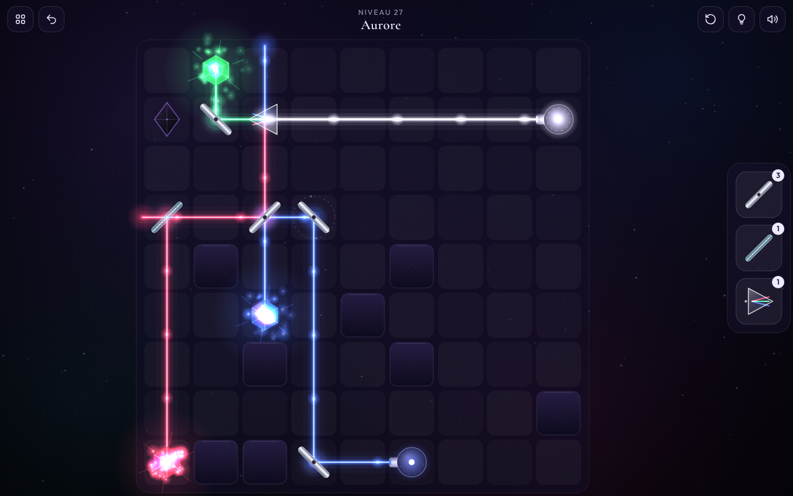

# KevLumen

Un puzzle de lumière à jouer dans le navigateur, à la souris ou au doigt.
Fais glisser des miroirs, des séparateurs, des prismes et des filtres pour guider des rayons colorés jusqu'aux cristaux.



## Jouer

Ouvre `index.html` dans un navigateur, c'est tout : le jeu tient dans un seul fichier.

## Règles

- **Source** : émet un rayon coloré.
- **Cristal** : s'allume quand il reçoit *exactement* sa couleur. Les couleurs s'additionnent : rouge + vert = jaune, rouge + bleu = magenta, vert + bleu = cyan, les trois = blanc.
- **Miroir** : renvoie la lumière à angle droit. Touche-le pour le faire pivoter.
- **Séparateur** : laisse passer le rayon et le reflète en même temps.
- **Prisme** : décompose la lumière (rouge à gauche, vert tout droit, bleu à droite). Il ne prend la lumière que par l'arrière.
- **Filtre** : ne laisse passer que sa couleur.
- **Cristal d'ombre** : doit rester dans le noir.

## Contenu

- 30 niveaux en 6 chapitres : Reflets, Séparateurs, Filtres, Prismes, Ombres, Aurore.
- Indices, annuler, recommencer, étoiles et progression sauvegardée dans le navigateur.
- Ambiance sonore douce générée en direct (aucun fichier audio).

## Dossier `outils`

Les outils qui ont servi à fabriquer le jeu :

- `gabarit.html` : le jeu avant assemblage.
- `sim.js` : la simulation des rayons.
- `gen.js` et `build.js` : le générateur de niveaux et le solveur qui vérifie que chaque niveau a une solution.
- `levels.json` : les 30 niveaux.
- `mk.py` : assemble `gabarit.html`, `sim.js` et `levels.json` dans un seul `index.html`.

## Tests
Un test de fumée joue le jeu tout seul sur ordinateur, iPhone SE et Pixel 7 couché (Chromium) : il échoue sur toute erreur console, un bouton hors de l'écran impossible à atteindre, une page qui déborde ou une chute d'images/s.

```bash
npm install
npx playwright install chromium
npm test            # captures dans test-results/
```
Réglages propres au jeu : `tests/smoke.config.mjs`. La CI GitHub (`.github/workflows/tests.yml`) le lance sur chaque PR.
